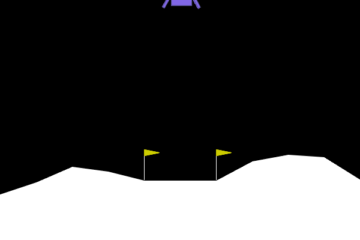
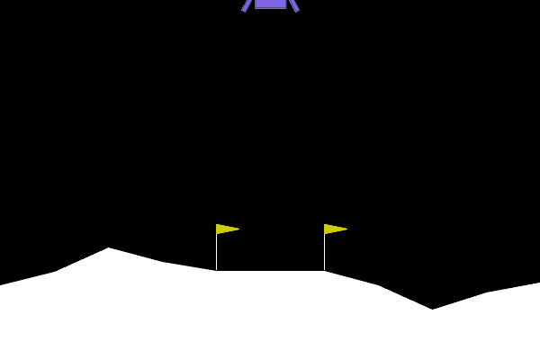
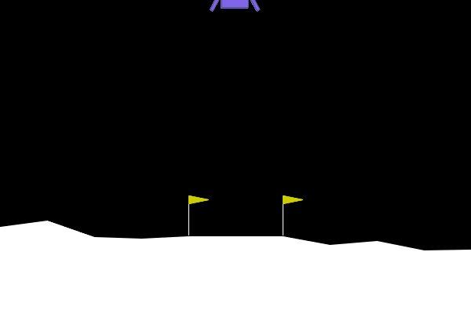
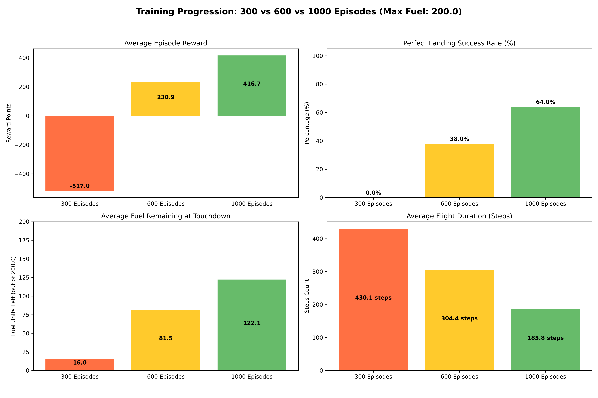
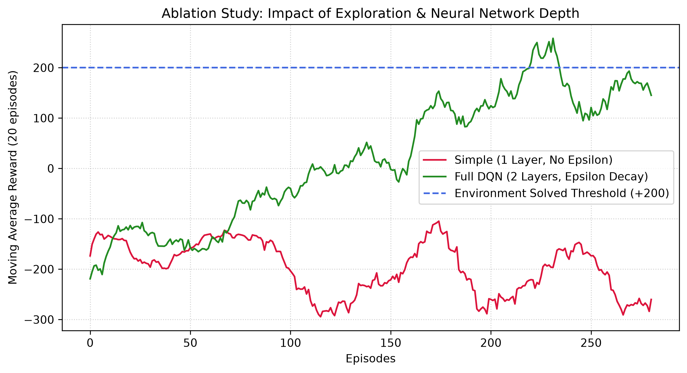
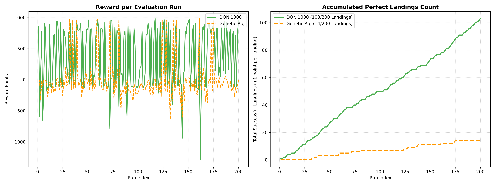

# 🚀 Autonomous Lunar Lander: Deep Q-Learning & Evolutionary Algorithms

This repository implements and evaluates **Deep Q-Network (DQN)** and **Genetic Algorithm (GA)** agents to solve the `LunarLander-v3` environment from Gymnasium. The primary objective is to achieve **ultra-precise, fuel-efficient, and perfectly centered landings** ($|X| \le 0.08$) while eliminating hovering, leg bounce, or out-of-bounds crashes.

---

## 📸 Visual Showcase

| Landing Demo 1 | Landing Demo 2 | Landing Demo 3 |
| :---: | :---: | :---: |
|  |  |  |
| *Controlled Descent & Centering* | *Engine Cutoff at Touchdown* | *Controlled Descent & Centering* |

---

## 🛠️ Custom Wrapper Architecture (`wrappers.py`)

To enforce strict, realistic flight dynamics and eliminate exploit behaviors (such as infinite hovering or bouncing), the raw environment is wrapped with `LimitedFuelAndImpactWrapper`:

- **Capped Fuel Capacity (200.0 Units):** Deducts fuel on every main ($0.8$) and side ($0.2$) engine firing.
- **Narrow Target Pad ($|X| \le 0.08$):** Rewards landing strictly on the center pad while penalizing lateral drift.
- **Ground Thruster Lockout:** Applies severe penalties for firing engines while leg contact is active, forcing immediate engine cutoff.
- **Strict Landing Conditions:** Requires simultaneous **dual-leg ground contact**, **zero active thrusters**, and a **10-step stability hold**.
- **Out-of-Bounds Enforcement (-300.0 Penalty):** Immediately terminates episodes if the vehicle drifts off-screen.

---

## 📊 Performance Analysis & Comparisons

### 1. Training Progression: 300 vs 600 vs 1000 Episodes



Evaluating model checkpoints across training epochs illustrates the clear convergence curve of the DQN policy:

- **300 Episodes (Underfitting):** The network has not converged. It exhibits a **0.0% success rate**, a severe average negative reward (**-517.0**), and depletes almost all fuel (**16.0 units left** out of 200.0) in chaotic attempts.
- **600 Episodes (Intermediate Convergence):** Success rate jumps to **38.0%** with a positive average reward of **230.9**, leaving **81.5 fuel units**.
- **1000 Episodes (Fully Trained):** Achieves a **64.0% Perfect Landing success rate**, **416.7 average reward**, cuts flight duration down to **185.8 steps**, and preserves **122.1 fuel units** (>60% of tank capacity).

---

### 2. DQN Full vs DQN Incomplete (Reward Shaping Impact)



Comparing the fully tuned agent (`DQN Full`) against a baseline trained without anti-hovering penalties and tight centering constraints (`DQN Incomplete`):

| Metric / Behavior | DQN Full (Strict Wrapper) | DQN Incomplete (Unrestricted Wrapper) |
| :--- | :---: | :---: |
| **Landing Alignment (X ≤ 0.08)** | 🚀 **Strictly Centered** | ⚠️ Off-Target / Drift |
| **Hovering & Leg Bouncing** | ❌ **Eliminated** | ⚠️ High Occurrence |
| **Engine Cutoff at Touchdown** | 🛑 **Immediate** | ⚠️ Continuous Fuel Waste |
| **Average Reward** | **+416.7** | ~ +180.0 |
| **Remaining Fuel Efficiency** | **122.1 / 200.0** | < 45.0 / 200.0 |

---

### 3. DQN vs Genetic Algorithm (RL vs Evolutionary Approach)



A comparative evaluation between Deep Reinforcement Learning (DQN) and Evolutionary Optimization (Genetic Algorithm):

- **Deep Q-Network (DQN):**
  - **Strengths:** Superior generalization capability when handling random initial state displacements ($|X_{init}| > 0.20$) and high initial lateral velocities.
  - **Performance:** Consistently stabilizes the lander over required hold-step windows.
- **Genetic Algorithm (GA):**
  - **Strengths:** Rapid convergence on fixed trajectories with zero gradient-computation overhead.
  - **Limitations:** Higher sensitivity to unseen random seeds, resulting in lower success rates when environment initial conditions vary significantly.

---

## 🚀 How to Run

**Why uv?**  
This project uses `uv` to strictly pin and enforce the precise Python version required by Gymnasium and PyTorch dependencies, avoiding C++ build tool errors or environment mismatches, while providing lightning-fast virtual environment initialization.

Execute all pipeline steps sequentially from your terminal:

```powershell
# 1. Install required dependencies (using uv for version pinning and ultra-fast setup)
uv pip install gymnasium torch numpy matplotlib imageio

# 2.1 Train the full DQN model (1000 episodes, 200.0 max fuel)
.\.venv\Scripts\python.exe train.py --mode full --episodes 1000 --max_fuel 200.0

# 2.2 Train the basic DQN (1000 episodes, 200.0 max fuel)
.\.venv\Scripts\python.exe train.py --mode simple --episodes 1000 --max_fuel 200.0

# 2.3 Train the Genetic Algorithm model (1000 generations)
.\.venv\Scripts\python.exe genetic_train.py --generations 1000 --pop_size 30 --max_fuel 200.0

# 4. Evaluate model performance with visual rendering
.\.venv\Scripts\python.exe Evaluate.py --mode dqn --model models/dqn_1000.pt --env_type custom

# 5. Generate landing GIFs
.\.venv\Scripts\python.exe generate_gif.py --model models/dqn_full.pt --output assets/landing_demo.gif --max_fuel 200.0

# 6. Run comparative benchmarks and update plot figures
.\.venv\Scripts\python.exe compare_models.py --model300 models/dqn_300.pt --model600 models/dqn_600.pt --model1000 models/dqn_1000.pt --max_fuel 200.0
.\.venv\Scripts\python.exe compare_genetic.py --dqn_model models/dqn_1000.pt --ga_model models/genetic_best.pt --runs 200

# 7.1 Train and run comparative benchmarks between Full DQN and Simple
.\.venv\Scripts\python.exe compare_train.py

# 7.2 Train and run comparative benchmarks between Full DQN and Genetic
.\.venv\Scripts\python.exe compare_genetic_train.py 
```

---

## 💻 Repository Structure

```text
.
├── assets/                                  # Visual assets for documentation
│   ├── landing_demo.gif                     # Recorded GIF of optimal landing 1
│   ├── landing_demo2.gif                    # Recorded GIF of optimal landing 2
│   ├── landing_demo3.gif                    # Recorded GIF of optimal landing 3
│   ├── training_comparison_300_600_1000.png # 3-checkpoint comparative dashboard
│   ├── dqn_full_vs_incomplete.png           # Reward shaping comparison chart
│   ├── dqn_vs_genetic.png                   # RL vs GA comparison chart
│   └── dqn_custom_vs_standard.png           # Environment benchmark comparison
├── models/                                  # Saved PyTorch model checkpoints
│   ├── dqn_300.pt
│   ├── dqn_600.pt
│   ├── dqn_1000.pt
│   ├── baseline_no_exploration.pt
│   └── genetic_best.pt
├── agent.py                                 # DQNAgent class & PyTorch network architecture
├── wrappers.py                              # LimitedFuelAndImpactWrapper implementation
├── train.py                                 # Main training loop script
├── genetic_train.py                         # Evolutionary optimization script
├── evaluate.py                              # Interactive evaluation script (terminal & visual)
├── generate_gif.py                          # Smart GIF generator with infinite loop support
├── compare_train.py                         # Live training benchmark comparing Full DQN and Simple DQN
├── compare_genetic_train.py                 # Live training benchmark comparing DQN and Genetic Algorithm
├── compare_models.py                        # Automated checkpoint comparison dashboard
├── compare_genetic.py                       # DQN vs Genetic Algorithm benchmark script
└── README.md                                # Single-file project documentation
```
